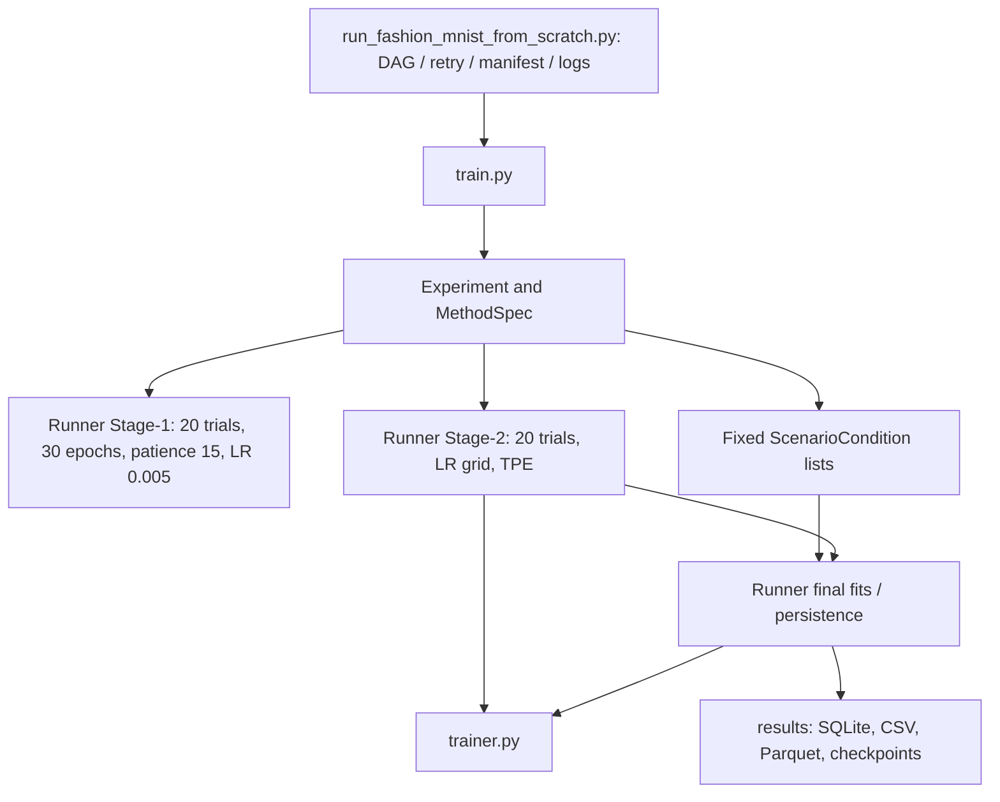

# Fashion-MNIST — experiment execution architecture

The repository uses a single training and result-persistence engine. The
scientific definitions and methods live in `core/experiment.py`; the executable
loops live in `core/trainer.py`; Optuna, checkpoint selection, final-run seeds
and results are coordinated by `core/experiment_runner.py`.



## Module responsibilities

| Module | Responsibility |
|---|---|
| `train_all.py` | Run the complete experiment from zero |
| `train.py` | CLI arguments and validation, including single-condition `--scenario-index` |
| `core/experiment_paths.py` | Canonical paths for architecture, methods, guides, cross-fitting and ablations |
| `core/experiment.py` | Experiment coordination, `MethodSpec` per-method settings and `ScenarioCondition` |
| `core/experiment_runner.py` | Stage-1 architecture and Stage-2 Optuna searches, LR selection, deterministic run IDs, saving/evaluation/checkpoint aliases, shared scenario runner |
| `core/trainer.py` | Numerical model training for ERM, RG, KD, SPL, MentorNet-PD |
| `core/dataset_builder.py` | Dataset splits, fixed noise labels, and reference logits |
| `core/crossfit_data.py` | Two-fold partitioning and out-of-fold reference logits |
| `core/experiment_scenarios/crossfit_conditions.py` | Declarative learner cross-fitting conditions |
| `core/experiment_scenarios/crossfit_guide_conditions.py` | Declarative fold-guide training conditions |
| `core/model_factory.py` | Model classes, construction, and Optuna architecture-key mapping |
| `core/utils.py` | Random seeds, finite-metric checks, checkpoints, and Parquet I/O |
| `core/experiment_scenarios/*.py` | Declarative ablations, out-of-fold and mean-one conditions only |
| `eval.py` | Public evaluation CLI and option dispatch |
| `core/evaluation_summary.py` | CSV consolidation, per-condition statistics, selected Optuna parameters |
| `core/evaluation_diagnostics.py` | Guide memorization and RG weight-allocation metrics |
| `core/evaluation_distributions.py` | Checkpoint-based per-sample CE distributions and KDE plots |

## Experiment protocol

For a reproducible complete experiment, the top-level
`run_fashion_mnist_from_scratch.py` should be used. It deliberately passes
the standard Stage-2 LR grid without RG scaling. Stage 1 retains its fixed LR of 0.005.

- Stage 1: 20 trials/model, 30 epochs maximum, early-stopping patience 15,
  LR 0.005; architecture is frozen once selected.
- Stage 2: 20 trials per condition, categorical LR `[0.01, 0.005, 0.001]`
  sampled by standard seeded Optuna TPE. The method-specific loss parameters 
  are sampled together with LR. Method search uses patience 30 for every 
  searched method, monitoring validation CE.
- Five final runs per main condition: seeds 43–47, 300 epochs each.
- Optimization controls: ERM at the selected RG LR and RG mean-one
  at the same selected RG LR and selected RG loss parameters.
- Cross-fitting fold guides use fixed LR 0.005, as do the full ResNet20 guides. Ablations reuse the CNN 40% / ResNet20 40% RG-selected LR.
- `--resume` in the top-level script retries failed conditions and resumes
  interrupted trials from epoch 1 with their original parameters and seed,
  and completes missing final runs. The first run requires `results/` empty.

The direct `train.py` interface retains optional optimization controls for independent investigations.

## Evaluation commands

```bash
python eval.py
python eval.py --stats
python eval.py --guide-memorization
python eval.py --rg-weight-allocation
python eval.py --selected-hyperparameters
python eval.py --detailed --architecture CNN --noise-ratio 0.4 --device cuda
```

`eval.py` is the only evaluation command entry point. The `core/evaluation*`
modules contain reusable computations and do not start jobs when imported.
The experiment executor invokes the same CLI for final diagnostic steps.

Experiment directory names and evaluator paths are defined in [OUTPUT_LAYOUT.md](OUTPUT_LAYOUT.md).

### MentorNet-PD

`models/mentornet_pd.py` defines the pretrained MentorNet model, synthetic PD
curriculum generation and inference. The CLI's `mentornet-pretrain` stage trains
it once, and all StudentNet trials and runs load that checkpoint through
`trainer.train_model_mentornet_pd()`.
